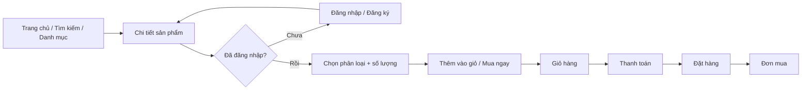
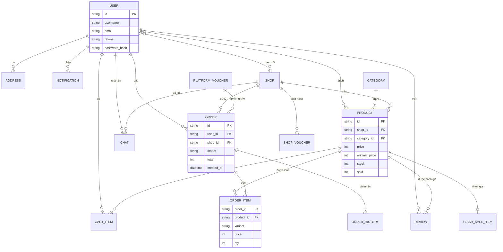
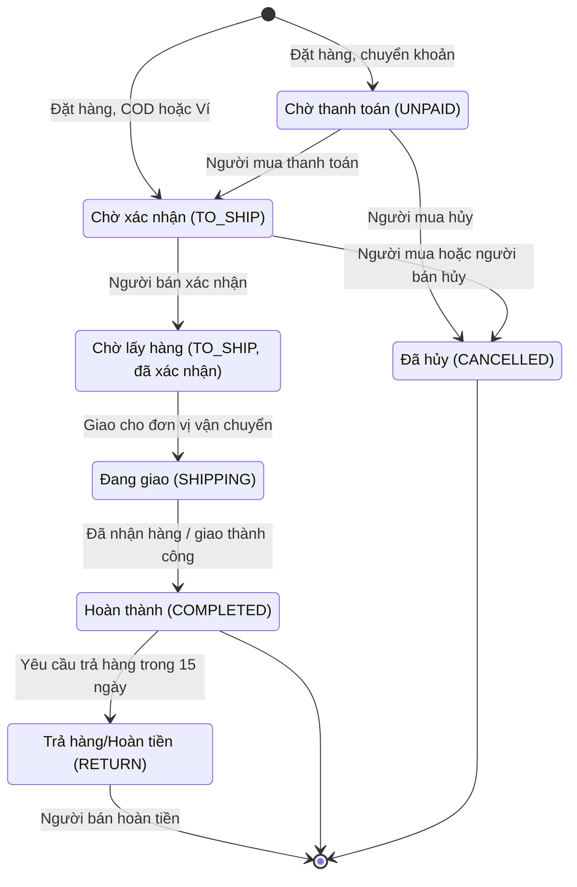

# ShopVui – Website mô phỏng sàn thương mại điện tử

## Web demo công khai

Profile VPS mới: `../docs/public-deploy.md`. Khách tự đăng ký qua Turnstile, COD/ví mô phỏng, riêng SePay chuyển tiền thật khi người vận hành bật và cấu hình. Trang checkout và QR cảnh báo rõ, không giao hàng thật/không hoàn tiền bank vào ví giả. Bản local bên dưới vẫn tắt SePay.

## Bộ demo lặp lại — 26/11/2026

Mở `http://127.0.0.1:8000/#/shop/oms`. 10 sản phẩm EZMART giảm đúng 50%, ảnh chụp local kèm `assets/images/ezmart/credits.html`; cache sửa giá/ảnh cũ không ghi đè danh mục. Bản hiện tại bật **OMS_DEMO_MODE=1**, chỉ thanh toán ví/COD mô phỏng và không có QR ngân hàng thật. Tài khoản của lượt hiện hành và 17 link bài DOM/RMA: `../backend/storage/demo/LUOT-HIEN-TAI.md`. Chuẩn bị lượt mới tại backend bằng `npm run demo:refresh`; nút khôi phục trong web chỉ xóa cache trình duyệt. Xem `../docs/demo-repeatable.md` và `../docs/deployment-readiness-20261126.md`. Các khả năng SePay tiền thật bên dưới chỉ áp dụng khi tắt demo mode sau khi được duyệt riêng.

## Bản hiện hành — 25/11/2026

Tài khoản, ví mô phỏng và đơn EZMART đã lưu trên máy chủ, **không còn đăng nhập bằng tài khoản LocalStorage `demo`**. Chạy backend + frontend theo README ở thư mục gốc rồi bấm **Đăng Ký**. Mỗi tài khoản mới nhận 6.000.000đ mô phỏng một lần, đăng nhập máy khác vẫn giữ ví/đơn. Các shop mẫu khác chỉ để xem; chỉ EZMART nhận đơn.

Chuyển khoản dùng **SePay tiền thật**, không có nút tự xác nhận demo. Nếu chưa cấu hình SePay, dùng ví mô phỏng hoặc COD. Tiền hoàn ngân hàng không được cộng thành số dư ví mô phỏng. Xem `../docs/shopvui-server-accounts.md`.

**Các phần bên dưới mô tả bản demo cũ**, không dùng hướng dẫn mở file trực tiếp, tài khoản demo hoặc LocalStorage làm mô tả đăng ký/thanh toán hiện hành.

Website demo **lấy cảm hứng từ giao diện và luồng mua sắm của các sàn TMĐT phổ biến tại Việt Nam (như Shopee)**, làm tư liệu cho tiểu luận phân tích.
Tên thương hiệu, logo, shop, đơn hàng… đều là **giả lập**; website không liên kết với doanh nghiệp nào và không có giao dịch thật.

---

## 1. Cách chạy

| Cách | Thao tác |
|---|---|
| Nhanh nhất | Mở file `index.html` bằng Chrome/Edge (bấm đúp). |
| Khi trình bày (khuyến nghị) | Mở Terminal tại thư mục dự án, chạy `python3 -m http.server 8000`, rồi vào `http://localhost:8000` |

- Cần Internet để tải **ảnh sản phẩm** và **font**. Nếu mất mạng, web vẫn chạy, ảnh được thay bằng biểu tượng.
- **Tài khoản demo:** `demo` / `Demo1234` (đã có sẵn giỏ hàng, đơn hàng ở nhiều trạng thái, thông báo, tin nhắn). Có thể tự đăng ký tài khoản mới.
- **Làm lại từ đầu:** bấm *Khôi phục dữ liệu mẫu* ở chân trang.
- **Mô phỏng 2 vai cùng lúc:** mở 2 tab – một tab mua hàng, một tab *Kênh Người Bán*. Dữ liệu tự đồng bộ giữa các tab.

---

## 2. Chức năng theo tác nhân

| Tác nhân | Chức năng |
|---|---|
| **Khách** (chưa đăng nhập) | Xem trang chủ (banner, danh mục, Flash Sale, ShopVui Mall, Tìm kiếm hàng đầu, Gợi ý hôm nay) · Tìm kiếm có gợi ý & lịch sử · Lọc (danh mục, nơi bán, khoảng giá, loại shop, đánh giá, khuyến mãi) · Sắp xếp (liên quan, mới nhất, bán chạy, giá) · Xem chi tiết sản phẩm, đánh giá, trang shop, Flash Sale · Đăng ký / Đăng nhập |
| **Người mua** | Giỏ hàng (chọn theo sản phẩm/shop/tất cả, đổi phân loại, số lượng, xóa, lưu vào Đã thích) · Thanh toán (địa chỉ, phương thức vận chuyển, voucher shop / voucher sàn / mã freeship, lời nhắn, 3 phương thức thanh toán) · Đặt hàng (tự tách đơn theo shop) · Đơn mua 7 trạng thái: thanh toán, hủy đơn có lý do, đã nhận hàng, trả hàng/hoàn tiền, mua lại · Đánh giá sản phẩm · Hồ sơ, sổ địa chỉ, đổi mật khẩu · Kho voucher · Sản phẩm đã thích · Theo dõi shop · Thông báo · Chat với shop |
| **Người bán** (Kênh Người Bán) | Bảng điều khiển: việc cần làm, doanh số, đơn hàng, lượt truy cập, tỉ lệ chuyển đổi, biểu đồ doanh số 7 ngày · Quản lý đơn: xác nhận → giao cho ĐVVC → đã giao, hủy đơn, chấp nhận hoàn tiền · Quản lý sản phẩm: thêm / sửa / ẩn / xóa, phân loại hàng, ảnh · Xem đánh giá shop |
| **Hệ thống** (tự động) | Tính phí vận chuyển · Kiểm tra điều kiện & áp voucher · Tách đơn theo shop · Trừ / hoàn tồn kho · Cập nhật "Đã bán" · Sinh thông báo · Chat trả lời tự động |

> Ở bản demo, Kênh Người Bán cho phép chọn **bất kỳ shop nào** để quản lý (ô "Shop đang quản lý" ở góc trên) – hệ thống thật sẽ phân quyền theo tài khoản người bán.

**Duyệt đơn ở Kênh Người Bán (demo)**

1. Đăng nhập (ví dụ `demo` / `Demo1234`) → bấm **Kênh Người Bán** ở góc trên bên trái.
2. Chọn đúng shop đã bán đơn đó ở ô **Shop đang quản lý** (tên shop hiện trên đơn trong *Đơn Mua*). Đơn mẫu đang chờ duyệt thuộc shop **Minh Long Mobile**. Cách nhanh hơn: trong *Đơn Mua* bấm link "Kênh Người Bán" ở dòng mẹo của đơn – trang sẽ tự chọn đúng shop.
3. **Quản Lý Đơn Hàng** → tab *Chờ xác nhận* → **Xác nhận đơn** → tab *Chờ lấy hàng* → **Giao cho ĐVVC** → tab *Đang giao* → **Đã giao (mô phỏng)**.
4. Quay lại *Đơn Mua* của người mua để thấy trạng thái, mốc thời gian và thông báo cập nhật; đơn hoàn thành thì bấm **Đánh Giá**.

**Luồng mua hàng chính**



---

## 3. Danh sách màn hình (route)

| Màn hình | Đường dẫn |
|---|---|
| Trang chủ | `#/` |
| Tìm kiếm / Danh mục | `#/search?keyword=...` · `#/category/:id` |
| Chi tiết sản phẩm | `#/product/:id` |
| Trang shop | `#/shop/:id` |
| Flash Sale | `#/flash-sale` |
| Giỏ hàng · Thanh toán *(cần đăng nhập)* | `#/cart` · `#/checkout` |
| Đăng nhập · Đăng ký | `#/login` · `#/register` |
| Hồ sơ · Địa chỉ · Đổi mật khẩu | `#/user/account/profile` · `/address` · `/password` |
| Đơn mua · Chi tiết đơn | `#/user/purchase?type=all\|unpaid\|toship\|shipping\|completed\|cancelled\|return` · `#/user/order/:id` |
| Thông báo · Kho voucher · Đã thích | `#/user/notifications` · `#/user/vouchers` · `#/user/likes` |
| Kênh Người Bán | `#/seller` · `#/seller/orders` · `#/seller/products` · `#/seller/products/new` · `#/seller/reviews` |
| Trợ giúp | `#/help` |

---

## 4. Kiến trúc & cấu trúc thư mục

- **SPA (Single Page Application)** viết bằng HTML/CSS/JavaScript thuần – không framework, không cần cài đặt hay build.
- **Định tuyến phía client** bằng hash (`#/...`), nên chạy được cả khi mở trực tiếp file.
- **Chia 3 tầng:** Dữ liệu → Nghiệp vụ → Giao diện. Giao diện chỉ gọi hàm nghiệp vụ, không sửa dữ liệu trực tiếp.
- **"Cơ sở dữ liệu"** là LocalStorage của trình duyệt (khóa `shopvui_db_v1`); mỗi thuộc tính tương ứng một bảng.

```
.
├── index.html               Trang duy nhất của SPA, nạp CSS/JS theo thứ tự tầng
├── README.md
└── assets/
    ├── css/style.css        Toàn bộ giao diện (có responsive cho điện thoại)
    └── js/
        ├── data.js          Dữ liệu mẫu: 16 danh mục, 20 shop, 189 sản phẩm, Flash Sale
        ├── core/            ── TẦNG DỮ LIỆU & NGHIỆP VỤ
        │   ├── utils.js     Định dạng tiền, bỏ dấu tiếng Việt, ngẫu nhiên có seed…
        │   ├── db.js        CSDL giả lập trên LocalStorage + đồng bộ giữa các tab
        │   ├── catalog.js   Truy vấn sản phẩm, tìm kiếm/lọc/sắp xếp, Flash Sale, đánh giá
        │   └── services.js  Tài khoản, địa chỉ, giỏ hàng, voucher, tính tiền, đơn hàng,
        │                    đánh giá, thông báo, chat, kênh người bán, dữ liệu demo
        ├── ui/              ── TẦNG GIAO DIỆN DÙNG CHUNG
        │   ├── icons.js     Icon SVG + logo
        │   ├── components.js Thẻ sản phẩm, sao, phân trang, modal, toast, voucher, form địa chỉ
        │   └── layout.js    Header (4 kiểu), footer, cửa sổ chat
        ├── pages/           ── CÁC MÀN HÌNH
        │   ├── home.js  search.js  product.js  cart.js  checkout.js
        │   ├── auth.js  user.js  seller.js
        │   └── misc.js      Trang shop, Flash Sale, Trợ giúp, 404
        ├── router.js        Bảng route + điều hướng, chặn trang cần đăng nhập
        └── app.js           Khởi động ứng dụng
```

---

## 5. Mô hình dữ liệu

| Thực thể | Thuộc tính chính |
|---|---|
| `users` | id, username, email, phone, password (đã băm), name, gender, birthday |
| `addresses` | id, userId, name, phone, province, ward, detail, type (nhà riêng/văn phòng), isDefault |
| `categories` | id, name, image, subCategories |
| `shops` | id, name, location, type (mall / yêu thích+ / yêu thích / thường), rating, followers, vouchers |
| `products` | id, name, categoryId, subCategory, shopId, brand, price, originalPrice, stock, sold, rating, ratingCount, variants, variantPrices, images, location, warranty, returnPolicy |
| `cart` | id, userId, productId, variant, qty, selected |
| `orders` | id, code, userId, shopId, items[], address, shipping, payment, amounts, vouchers, status, confirmed, history[] |
| `reviews` | id, productId, userId, orderId, rating, comment, variant |
| `likes`, `follows`, `savedVouchers` | bảng liên kết người dùng ↔ sản phẩm / shop / voucher |
| `notifications`, `chats` | thông báo và hội thoại người mua – shop |

> `orders.items` và `orders.history` được lưu lồng trong đơn hàng (kiểu tài liệu – document). Khi chuyển sang CSDL quan hệ, đó sẽ là bảng `ORDER_ITEM` và `ORDER_HISTORY` như sơ đồ dưới.



---

## 6. Quy tắc nghiệp vụ

**Trạng thái đơn hàng**



**Voucher** – mỗi lần thanh toán dùng tối đa *1 voucher của mỗi shop + 1 mã giảm giá ShopVui + 1 mã miễn phí vận chuyển*.

| Mã | Loại | Điều kiện |
|---|---|---|
| FREESHIP30 | Miễn phí vận chuyển | Giảm tối đa ₫30k phí ship, đơn từ ₫0 (tự áp dụng) |
| FREESHIPXTRA | Miễn phí vận chuyển | Giảm tối đa ₫70k phí ship, đơn từ ₫300k |
| SVNEW30K | Giảm giá | Giảm ₫30k, đơn từ ₫99k, chỉ cho đơn đầu tiên |
| SALE1111 | Giảm giá | Giảm 11% tối đa ₫111k, đơn từ ₫300k |
| SV100K | Giảm giá | Giảm ₫100k, đơn từ ₫1tr |
| MALL12 | Giảm giá | Giảm 12% tối đa ₫500k, chỉ tính sản phẩm Mall từ ₫2tr |
| Voucher shop | Giảm giá | Giảm ₫10k (đơn từ ₫99k), giảm 5% có mức trần; shop Mall thêm mã ₫100k. Tự chọn mã có lợi nhất |

**Các quy tắc khác**

- **Phí vận chuyển** (theo vị trí shop → tỉnh nhận): cùng tỉnh ₫15.000 · cùng miền ₫22.000 · khác miền ₫32.000 · hàng quốc tế ₫45.000; +₫2.000 cho mỗi sản phẩm thêm. *Hỏa Tốc 2 giờ* (₫45.000) chỉ khi cùng tỉnh; *Tiết Kiệm* rẻ hơn nhưng chậm hơn.
- **Tách đơn:** giỏ hàng có sản phẩm của N shop → N đơn hàng. Giảm giá của sàn được chia cho từng đơn theo tỉ lệ giá trị.
- **Tồn kho:** trừ khi đặt hàng, hoàn lại khi hủy; "Đã bán" tăng khi đơn hoàn thành.
- **Hủy đơn:** chỉ khi chưa thanh toán hoặc người bán chưa xác nhận; đơn đã thanh toán được hoàn tiền về ví.
- **Đánh giá:** chỉ đơn *Hoàn thành*, mỗi đơn một lần (1–5 sao + bình luận).
- **Tài khoản:** tên đăng nhập 4–20 ký tự; mật khẩu 8–16 ký tự gồm chữ hoa, chữ thường và số; phải đăng nhập trước khi thêm vào giỏ.
- **Địa chỉ:** 34 tỉnh/thành, 2 cấp (Tỉnh/Thành phố – Phường/Xã) theo sắp xếp đơn vị hành chính từ 01/07/2025.

---

## 7. Gợi ý khai thác cho tiểu luận

1. **Phân tích giao diện (UI/UX):** chụp từng màn hình ở mục 3; so sánh bố cục với sàn thật (header cam, Flash Sale đếm ngược, nhãn Mall/Yêu thích, giỏ hàng nhóm theo shop…).
2. **Phân tích chức năng:** dùng bảng mục 2 để vẽ sơ đồ Use Case (3 tác nhân: Khách, Người mua, Người bán).
3. **Phân tích dữ liệu:** dùng mục 5 để vẽ ERD / sơ đồ lớp.
4. **Phân tích quy trình:** sơ đồ trạng thái đơn hàng, luồng mua hàng, luồng xử lý đơn của người bán (mục 2, 6).
5. **Mô hình kinh doanh:** voucher sàn & shop, Flash Sale, phân hạng shop Mall/Yêu thích, phí vận chuyển.
6. **Đánh giá & hạn chế:** xem mục 8 – ví dụ vì sao hệ thống thật cần máy chủ, CSDL, cổng thanh toán, phân quyền, bảo mật.

---

## 8. Giới hạn của bản demo

- Không có máy chủ / CSDL thật: dữ liệu nằm trong LocalStorage, **mỗi trình duyệt một bộ dữ liệu riêng**.
- Mật khẩu chỉ được "băm" đơn giản phía trình duyệt để minh họa – **không an toàn** cho hệ thống thật.
- Thanh toán, vận chuyển, chat, đăng nhập mạng xã hội đều là **mô phỏng**.
- Lược bỏ so với sàn thật: Xu, livestream/video, trả góp, quảng cáo, quản trị viên sàn, kết nối đơn vị vận chuyển và cổng thanh toán thật.

## 9. Nguồn dữ liệu

- Ảnh và thông tin gốc của sản phẩm: bộ dữ liệu thử nghiệm công khai **DummyJSON** (dummyjson.com). Tên sản phẩm đã được Việt hóa, giá quy đổi sang VNĐ; shop, phân loại, đánh giá, Flash Sale là dữ liệu giả lập.
- Font chữ: Roboto (Google Fonts). Icon: SVG tự vẽ trong `assets/js/ui/icons.js`.
